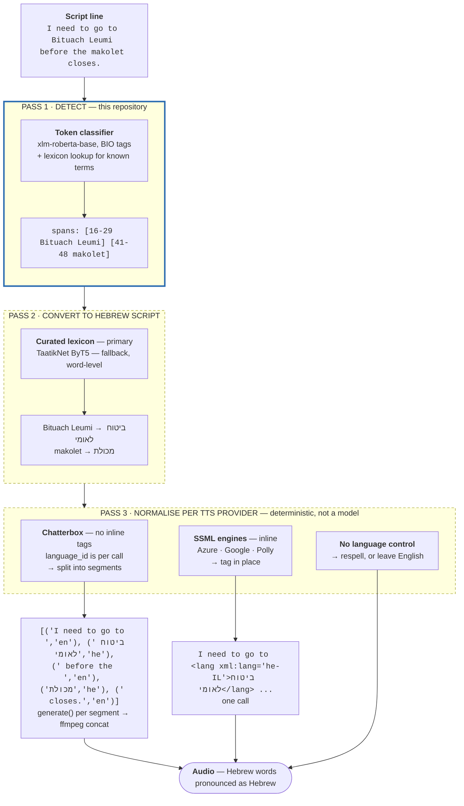
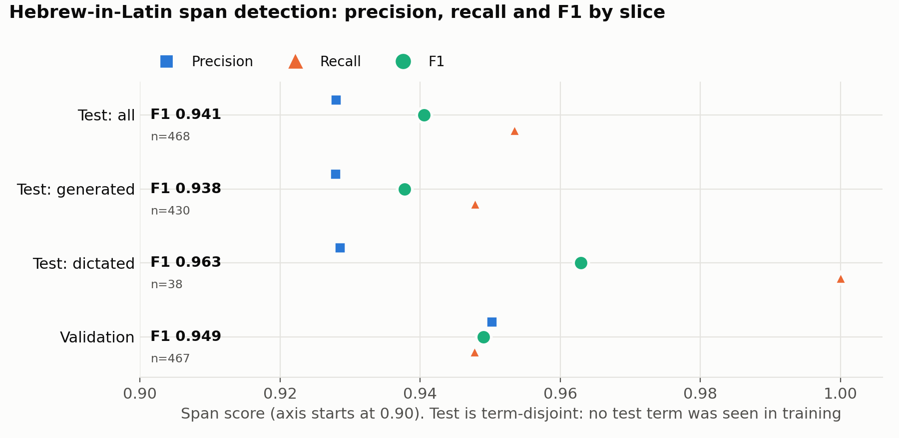
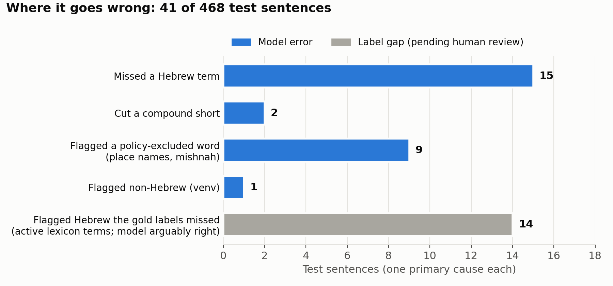

# Hebrew-Latin-Token-Classifier

A token classifier that identifies **Hebrew words written in Latin characters**
inside English text — *"I'm going to **Bituach Leumi** today"*, *"pick up some
**bamba** from the **makolet**"*.

Nothing like it exists. There is no `heb_Latn` label in GlotLID v3, `lid.176` or
`lid218e`; no token-level code-switching model covers Hebrew; and no Hebrew-English
code-switching corpus is published anywhere. Survey:
[Hebrew-Small-Models-Planning/docs/prior-art.md](https://github.com/danielrosehill/Hebrew-Small-Models-Planning/blob/main/docs/prior-art.md).

**Status 2026-10-15: released.** Both are public on Hugging Face:

- **Model:** [`danielrosehill/hebrew-latin-token-classifier`](https://huggingface.co/danielrosehill/hebrew-latin-token-classifier).
  Span F1 is **0.941** on the term-disjoint test set (P 0.928 / R 0.953), with 0 false
  positives on the 58 hard-negative sentences.
- **Corpus:** [`danielrosehill/hebrew-latin-code-switching`](https://huggingface.co/datasets/danielrosehill/hebrew-latin-code-switching),
  4,737 sentences, of which 458 are dictated.
- **Demo:** [Space `danielrosehill/hebrew-latin-token-classifier`](https://huggingface.co/spaces/danielrosehill/hebrew-latin-token-classifier).
  It highlights detected spans and renders them for TTS, as Chatterbox segments and as
  SSML. It also walks through the use cases. Source is in [`demo/`](demo/); see
  [The demo Space](#the-demo-space).
- **API:** [Replicate `danielrosehill/hebrew-latin-token-classifier`](https://replicate.com/danielrosehill/hebrew-latin-token-classifier)
  (CPU). Inputs are `text` and `threshold`; it returns the same span list as
  `training/predict.py`. Packaging and push steps are in [`replicate/`](replicate/README.md).

**Why it exists, in the author's voice:** a 6½-minute voice note,
[`docs/voice-note/why-this-model.mp3`](docs/voice-note/why-this-model.mp3), with a
[transcript](docs/voice-note/transcript.md). It covers the podcast problem that
prompted the model, why language ID and translation don't solve it, the three-pass
pipeline, and the open question of words like *Shabbat*. The same clip is embedded
on the [model card](https://huggingface.co/danielrosehill/hebrew-latin-token-classifier#the-authors-note-audio).

An **audio** sibling, word-level English/Hebrew identification in speech, is tracked
separately in
[Hebrew-English-Word-LID-Audio](https://github.com/danielrosehill/Hebrew-English-Word-LID-Audio)
(planning stage).

280 human review tasks from round 2 are still open. Their spans are masked rather than
labelled; see [Output format](#output-format).

Planning, requirements and the downstream use case live in the sibling repo
[**Hebrew-Small-Models-Planning**](https://github.com/danielrosehill/Hebrew-Small-Models-Planning).
This repo is the first of the small models that plan describes.

## The use case: text-to-speech that stops botching Hebrew

English text-to-speech reads romanized Hebrew as if it were English. *makolet* comes
out as "MACK-oh-let" and *mashkanta* gets an English stress pattern. The guttural in
*chatzer* turns into an English "ch", as in *church*. No voice gets these right,
because nothing tells it the word is Hebrew.

The fix this classifier enables:

1. **Find** the Hebrew spans in the script (this model).
2. **Convert** them to Hebrew script.
3. **Send** each span to the TTS engine with the **Hebrew language identifier**: a
   separate `language_id="he"` call for Chatterbox, or `<lang xml:lang="he-IL">` for
   SSML engines (Azure, Google, Polly).

The rest of the sentence stays English, and the Hebrew word comes out in Hebrew.

**The first consumer is [My Weird Prompts](https://myweirdprompts.com)**, an
AI-generated podcast produced in Jerusalem and voiced by
[Chatterbox TTS](https://github.com/resemble-ai/chatterbox). Many of its episodes
contain Hebrew words, and mispronouncing them has been a long-standing problem.
Fixing that is why this classifier exists.

It is deliberately general-purpose, though. The same spans are useful wherever
romanized Hebrew appears in English text: dictation post-processing, search, subtitle
QA, or any TTS pipeline that serves English speakers in Israel.

This repo is **pass 1 of three**. Pass 2 converts the detected spans to Hebrew script;
pass 3 normalises them into whatever syntax the target TTS engine wants — which
differs per provider, and for Chatterbox means segmenting rather than tagging.
[**docs/pipeline.md**](docs/pipeline.md) has the architecture, the interface contract
between passes, and a working Chatterbox Multilingual code sample.



### The North Star

**makolet** — a neighbourhood corner shop. Dictated 2026-09-22 it came back as
*"macaullete"*; no model tried has ever got it. It is common in the English speech of
English-speakers in Israel and absent from every major speech corpus. **If a rule
would exclude *makolet*, the rule is wrong.**

The default posture is **conservative**: a flagged span is not a label, it is work —
a sentence split, a separate speech call, audio stitched back together. A miss costs
nothing. A false positive pays all of that to make the output worse. Judgement calls
(toponyms, Israel-English, words current ASR handles) are excluded by default and
recoverable with `--posture expansive`, no regeneration needed. See
[docs/taxonomy.md](docs/taxonomy.md).

### Chatterbox references

- Repository: <https://github.com/resemble-ai/chatterbox> (MIT)
- Weights: <https://huggingface.co/ResembleAI/chatterbox>
- Package: <https://pypi.org/project/chatterbox-tts/>
- API notes verified from source, since the README omits most of it:
  [chatterbox-tts.md](https://github.com/danielrosehill/Hebrew-Small-Models-Planning/blob/main/docs/reference/chatterbox-tts.md)
- Language specification and a code-switched code sample: [docs/pipeline.md](docs/pipeline.md#language-specification--the-actual-signature)

## How the corpus is built

Generate, annotate blind with a second model, adjudicate, review only what is
contested. The plan, target sizes and category balance are in
[`docs/data-plan.md`](docs/data-plan.md); the labelling rules are in
[`docs/annotation-policy.md`](docs/annotation-policy.md).

```
[0] expand_terms.py       lexicon + models        ->  data/terms.csv        743 terms
[1] generate_samples.py   term-seeded positives   ->  data/generated/sentences.jsonl
[1b] generate_negatives.py four kinds of negative ->  data/generated/sentences.jsonl
[2] auto_annotate.py      blind, different model  ->  data/generated/annotations.jsonl
[3] adjudicate.py         agree / disagree        ->  review/queue.json + agreement.json
[4] review UI             human, contested only   ->  review/decisions.json
[5a] fetch_dictated.py    read-aloud sentences    ->  data/dictated/sentences.jsonl
[5] build_splits.py       term-disjoint BIO       ->  data/corpus/{train,validation,test}.jsonl
[6] publish_dataset.py    Hugging Face dataset    ->  danielrosehill/hebrew-latin-code-switching
[7] training/train.py     HF Jobs, A10G           ->  danielrosehill/hebrew-latin-token-classifier
[6b] publish_space.py     Hugging Face Space      ->  danielrosehill/hebrew-latin-span-review
[8] demo/                 Hugging Face Space      ->  danielrosehill/hebrew-latin-token-classifier
[9] replicate/            Replicate (cog, CPU)    ->  r8.im/danielrosehill/hebrew-latin-token-classifier
```

Four design rules, each answering a way this normally goes wrong:

- **Term-seeded generation.** The model is given a term and asked for sentences using
  it, not asked to "write sentences with Hebrew words". Coverage and category balance
  are guaranteed rather than hoped for, and the span is known by construction — a
  generation where the seed term does not word-boundary match is rejected outright.
- **Blind annotation by a different model family.** The annotator is not told the seed
  term. Two passes from one model agreeing proves the model is consistent, not that it
  is right. This pass also catches incidental terms the seeding did not intend.
- **Disagreement drives the human queue**, plus a **10% random audit of agreements**.
  The audit is not optional: without it, the only available number is how often two
  models disagree, which says nothing about how wrong the agreeing majority is.
- **Term-disjoint splits.** No seed term appears in more than one split. Splitting by
  sentence lets a model memorise a term in training and be scored on it at test,
  inflating the number by a wide margin and measuring the opposite of what this is for.
  `build_splits.py` fails loudly if any term leaks.

### Target

~2,600 generated sentences over ~500 terms, plus 360 usable records from the vendored
dataset. Roughly 5× the EnTaCs recipe (~500 utterances, romanized-class F1 **0.638**),
with the budget going into **more terms** rather than more sentences per term, because
generalisation to unseen terms is the point. Hard negatives get real budget — 500 of
them, including sentences built around the exact substring traps that corrupted the
vendored dataset's labels. ### Cost — measured, not guessed

Every LLM call logs its token usage to `data/usage.jsonl`, and
`scripts/estimate_cost.py` extrapolates from a pilot. Projected from a measured
36-sentence run to the 2,600-sentence target:

| Stage | Model | Cost |
| --- | --- | --- |
| Generate | `deepseek-flash` | $0.62 |
| Annotate | `qwen/qwen3.8-flash` | $2.21 |
| **Total** | | **$2.83** |

Same job on other models, for comparison — this is why the defaults are what they are:

| Model | Both passes |
| --- | --- |
| `qwen/qwen3.8-flash` | $2.71 |
| `deepseek-flash` | $3.38 |
| `deepseek-v4-pro` | $11.45 |
| `google/gemini-3.8-flash` | $20.02 |
| `anthropic/claude-sonnet-5:batch` | $27.75 |
| `anthropic/claude-sonnet-5` | $55.49 |

**Reasoning tokens are 95-99% of output on this workload** and are billed as output,
so the visible text is a small fraction of what you pay for. That is the dominant cost
term, and the obvious lever is batching several sentences into one annotation call to
amortise the reasoning preamble — not yet implemented.

DeepSeek figures are **off-peak**, which is half price. Peak is only 01:00-04:00 and
06:00-10:00 UTC on weekdays, so any evening or weekend run from Israel is off-peak
automatically. DeepSeek does **not** support `json_schema` structured output — the
client falls back to `json_object` with the schema in the system prompt, which works
reliably.

At under $3, cost is not a constraint on this corpus. Do not trade quality for it.

### Pilot run, committed

A 6-term, 18-sentence pilot is in `data/generated/` and `data/corpus/` as evidence the
pipeline works. Generator `anthropic/claude-sonnet-5`, annotator
`google/gemini-3.8-flash`:

| | |
| --- | --- |
| Sentences | 18 |
| Full agreement | 15 (83%) |
| Disagreement rate | **16.7%** — inside the healthy 5-25% band |
| Seed term rejected as absent | 0 |
| Annotator terms not found in text | 0 |
| Term leakage between splits | 0 |

Every disagreement was the same case: the generator seeded *tel aviv*, the annotator
declined to mark it. That is not noise — it is the unresolved place-name question in
`docs/annotation-policy.md` surfacing on the first run, which is what the adjudication
step is for.

## Running it

```bash
uv venv .venv && source .venv/bin/activate && uv pip install -e .

python scripts/expand_terms.py --target 500
python scripts/estimate_cost.py --compare       # price it before committing
python scripts/generate_samples.py   --per-term 3 --concurrency 16
python scripts/generate_negatives.py --per-kind 125 --concurrency 16
python scripts/auto_annotate.py      --model qwen/qwen3.8-flash
python scripts/adjudicate.py
python scripts/serve_review.py                # http://127.0.0.1:8765
python scripts/fetch_dictated.py              # dictated slice from the phone recordings
python scripts/build_splits.py
python scripts/publish_dataset.py             # dry run; add --push to upload

# train on Hugging Face Jobs (needs a Pro account); pushes the model PRIVATE
HF_TOKEN=$HUGGINGFACE_TOKEN hf jobs uv run --flavor a10g-small --secrets HF_TOKEN \
    training/train.py --push danielrosehill/hebrew-latin-token-classifier
```

Stages 1 and 2 are **resumable** — output is appended and completed work is skipped,
so an interrupted run continues where it stopped.

`DEEPSEEK_API_KEY`, `OPENROUTER_API_KEY` and `HUGGINGFACE_TOKEN` are read from the
environment; all three were verified live 2026-09-22. The provider is inferred from
the model name — `deepseek-*` goes direct to DeepSeek, everything else to OpenRouter —
and `--provider` / `--api-key` override.

`auto_annotate.py` **refuses to run if the annotator shares a model family with the
generator**, because agreement between two passes of one model measures consistency
rather than correctness. `--allow-same-family` overrides it.

### The review UI

One HTML file, no dependencies, no build step. It runs locally, or as a
**Hugging Face Space** so review works from any machine or phone:

```bash
python scripts/adjudicate.py                  # refresh the queue
python scripts/publish_space.py               # dry run
python scripts/publish_space.py --push        # -> huggingface.co/spaces/danielrosehill/hebrew-latin-span-review
```

The Space is `sdk: static` — no server, no build. The queue ships as a plain file
beside the page, decisions stay in the reviewer's `localStorage`, and nothing is sent
back. The trade is that decisions are per-browser: export `decisions.json` and commit
it. Re-run `publish_space.py` after every `adjudicate.py` to refresh the queue.
 Keyboard: <kbd>y</kbd> Hebrew,
<kbd>n</kbd> not Hebrew, <kbd>Enter</kbd> submit typed terms, <kbd>s</kbd> skip,
<kbd>u</kbd> undo. Progress is kept in `localStorage`, so the tab can be closed and
resumed. **Download decisions.json** into `review/`, then run `build_splits.py`.

Serving over HTTP is required — browsers block `fetch()` from `file://`, and opening
`review/index.html` directly shows a message saying so.

Expected volume at full scale: ~300-400 disagreements plus a 260-sentence audit, so
roughly **600 tasks** — one sitting, spent on genuinely ambiguous cases rather than on
2,600 obvious ones.

### The demo Space

`demo/` is a Gradio Space (`sdk: gradio`, CPU basic), separate from the review Space.
It runs pass 1 with `demo/predict.py`, a copy of `training/predict.py`. Keep the two
copies in sync. Pass 2 is an opt-in that uses TaatikNet (`malper/taatiknet`) as a
stand-in. Pass 3 renders Chatterbox `(text, language_id)` segments and SSML
`<lang xml:lang="he-IL">`. It also plays the author's voice note from
`demo/why-this-model.mp3`, a copy of `docs/voice-note/why-this-model.mp3`; keep the two
identical. To publish:

```bash
hf upload danielrosehill/hebrew-latin-token-classifier demo . --repo-type space --exclude "__pycache__/*"
```

Three things were verified on 2026-10-15 and are not obvious from the code:

- **The demo pins `transformers>=5`, not `<5`.** Gradio 6.30 requires
  `huggingface-hub>=1.16`, and every `transformers` 4.x requires `huggingface-hub<1.0`,
  so the training pin cannot be installed alongside it. The `<5` pin exists only
  because of `TrainingArguments.warmup_ratio`; inference works on v5.
- **TaatikNet is word-level.** Given the input `Bituach Leumi`, it returns one fused
  word. The demo therefore converts each word separately and strips the niqqud.
- **TaatikNet does not follow spelling conventions.** It returns *makolet* as מקולת
  rather than מכולת, and *Bituach Leumi* as בתוח לאמי. That is why the planned pass 2
  is lexicon-first. The Space labels the conversion as experimental.

Two examples were dropped from the Space because the model missed them: lowercase
*shoko* in "a bottle of shoko", and *tor* (appointment) in "the tor is in March".
Both are candidates for the next round of terms.

## The vendored dataset, and why it is no longer primary

[`danielrosehill/English-Hebrew-Mixed-Sentences`](https://huggingface.co/datasets/danielrosehill/English-Hebrew-Mixed-Sentences)
— 516 LLM-generated, human-read sentences, MIT, built for the
[`Whisper-Hebrish`](https://huggingface.co/danielrosehill/Whisper-Hebrish) ASR
fine-tune. The three JSONL splits are vendored under `data/source/`. The 516 WAVs are
**not** copied — this is a text task.

Its `hebrew_word` labels do not survive inspection. They were produced by **substring
search**:

| | Count | Of 474 labelled |
| --- | --- | --- |
| Label aligns with a word in the sentence | 360 | 76% |
| **Label matches only *inside* another word** | **114** | **24%** |
| No label at all (but Hebrew is present) | 42 | — |

`hi` was labelled from *t**hi**nk*; `har` from *P**har**m*; `ma` from *__ma__shav*;
`gan` from *maz**gan***; `ach` from *m**ach**som*; `chool` from *s**chool***. In all
114 of those records the real Hebrew term — *dud*, *mashkanta*, *mirsham*, *tlush*,
*maskoret*, *hashmal*, *chufshat leida* — is unlabelled.

The contamination reaches the term list: 12 of the 139 distinct terms
(`ach ani atem ein har hi ken latke lo ma mi supermarket`) **never occur as whole
words anywhere in the corpus**. A further 17 are ordinary English words (`at`, `hi`,
`lo`, `ken`, `baby`, `chicken soup`). Both sets are **quarantined** — kept with their
reason, excluded from automatic matching. 117 of 139 remain active, and those seed the
generation inventory.

> A substring check of labels against their sentences returns zero failures and looks
> like a clean bill of health. It proves nothing: passing it is exactly what a
> substring-generated label does. Word-boundary matching is the real test.

**What is kept.** The 360 aligned records join the corpus as a human-read,
independently-sourced slice — and the dataset's audio makes it the only part usable
for future speech work. Repairing the other 156 by hand is ~242 review tasks for at
most 516 sentences over 139 terms; generating gives more terms, controlled balance and
explicit negatives for comparable human effort. The repair path still works —
`scripts/annotate.py` builds that queue — it is simply no longer the main road.

## Output format

`data/corpus/{train,validation,test}.jsonl`:

```json
{"id": "1_3",
 "text": "... including a passport and a teudat zehut.",
 "spans": [{"start": 86, "end": 98, "surface": "teudat zehut", "term": "teudat zehut"}],
 "tokens": [["Opening", "O"], ["a", "O"], ..., ["teudat", "B-HE"], ["zehut", "I-HE"], [".", "O"]]}
```

Two labels plus `O`, CoNLL-style BIO. Multi-token terms are `B-HE I-HE`, which is why
the tag scheme is not a plain binary flag — 51 of 139 terms are multi-token.

Rows also carry `source` (`generated` / `dictated`) and `masked`: character spans with
**no label**. Two things go there. One is spans the models disagreed on that no human
has ruled on; until 2026-10-15 these were silently tagged `O`. The other is Israeli
person names in dictated sentences, on which the taxonomy has not ruled. `tokens`
still shows them as `O` for format compatibility. `training/train.py` gives them label
`-100`, so they carry no loss and are not scored.

### The dictated slice

`scripts/fetch_dictated.py` pulls the text of
[`English-Hebrew-Codeswitching-Sentences`](https://huggingface.co/datasets/danielrosehill/English-Hebrew-Codeswitching-Sentences).
Those are the sentences Daniel reads aloud for the Parakeet fine-tune
(`~/repos/github/audio-dictation/Parakeet-V2-Personal-Finetune`). Their `target_terms`
mix Hebrew vocabulary with people, places and tech terms, so labels are **recomputed**
rather than copied:

- A span is a word-boundary match of an active term in `terms.csv`, of an active term
  in `lexicon.csv`, or of a spelling variant of either, with exclusions applied.
- An `ambiguous` term is a span only if the sentence was written for it.
- Places and tech terms are `O`. The name and tech lists are read from the Parakeet
  repo's `data/israeli-names.json` and `data/tech-terms.json`.
- A sentence with no span and no known-negative target is **dropped**: every one of
  these sentences was written as code-switching, so an empty one is a lexicon gap
  (*JPost*, *haztarat hon* before `lexicon.csv` was added), not a negative.

`build_splits.py` then puts each dictated sentence in whichever split already holds
its terms, and drops a sentence whose terms sit in two different splits. On
2026-10-15, 458 sentences went in and 27 were dropped for that reason.

`lexicon.csv` had to be added to the matching because the generation inventory never
re-seeded some of the older terms it holds (*chufshat leida*, *pensia*, *Ynet*,
*Janglo*). That gap in `terms.csv` is real and also affects generation.

## Model

**Trained 2026-10-15.** `training/train.py` runs on Hugging Face Jobs (`a10g-small`):
8 epochs, lr 3e-5, batch 32, best checkpoint chosen on validation span-F1. It takes
about 3 minutes of training and costs a few cents. The model is pushed **private**,
then made public by hand after the numbers have been read.

| Test slice (term-disjoint) | Sentences | P | R | F1 |
| --- | --- | --- | --- | --- |
| All | 468 | 0.928 | 0.953 | 0.941 |
| Dictated | 38 | 0.929 | 1.000 | 0.963 |



Read the errors (`test_errors.jsonl` in the model repo) before trusting the precision
figure. No designed hard negative was flagged. The false positives are policy-excluded
place names (*Dizengoff*, *Ramat Gan*) and seeded sentences whose gold label is empty
because the annotator refused a real Hebrew word (*msabbaha*, *lechem*, *sakin*,
*od paam*). That second group is a **labelling gap, not a model error**, and the next
review pass should pick it up.



Both figures are rendered by `scripts/make_figures.py <dir with eval_results.json and
test_errors.jsonl> docs/figures`. The error categories are assigned per sentence from
term status in `data/terms.csv` and `data/exclusions.csv`; re-run it after retraining
and copy the PNGs to the model repo's `figures/`.

Inference traps, both verified 2026-10-15:

- Use `training/predict.py`, or `pipeline(..., aggregation_strategy="first")`. Only
  the first sub-token of each word is trained, so `"simple"` returns `mako` for
  *makolet*. The pipeline also splits on whitespace, so punctuation attaches to spans.
  `predict.py` pre-splits with `corpus.TOKEN_RE` and avoids both.
- `training/train.py` pins `transformers<5`. Version 5 removed
  `TrainingArguments.warmup_ratio`, and the first job died on it.

The model card source is `training/model-card/README.md`. Upload it to the model repo
by hand after retraining; `train.py` does not write it.

### Original plan

`xlm-roberta-base` fine-tuned for token classification, following the **EnTaCs**
English-Tamil code-switching recipe (arXiv 2603.26587) — the closest published
template, and deliberately small: ~500 utterances, three labels, CoNLL format.

EnTaCs reports macro-F1 **0.844** with the romanized class at **F1 0.638**. Plan for
roughly that on the romanized class, not 0.9. An imperfect classifier is still
useful here: it is paired with a lexicon that carries the high-frequency terms, and
precision is weighted over recall — a miss changes nothing, a false positive makes an
English word be read in Hebrew.

## Where this fits

Hebrew NLP is well served for **Hebrew-script** text and Hebrew speech. The gap is
specifically **Hebrew written in Latin letters inside English**, the way English
speakers in Israel actually write and talk. This project fills that gap and is meant
to sit beside these, not replace them:

| Organisation / project | What it does | Relation to this |
| --- | --- | --- |
| [ivrit.ai](https://huggingface.co/ivrit-ai) | Non-profit for Hebrew speech: ~3,300 h Hebrew speech corpus ([arXiv 2307.08720](https://arxiv.org/abs/2307.08720)), Whisper fine-tunes, a [Hebrew ASR leaderboard](https://ivrit-ai-hebrew-transcription-leaderboard.hf.space/) and a [Hebrew TTS Arena](https://ivrit-ai-tts-arena-hebrew.hf.space/about) | Hebrew-script speech. A detected span could be routed to their models; they do not cover English with embedded Hebrew |
| [DICTA](https://huggingface.co/dicta-il) | DictaBERT, Nakdan (vocalisation), DictaLM | Hebrew-script text only |
| [Phonikud](https://github.com/thewh1teagle/phonikud) | Hebrew script to IPA, for Hebrew TTS | A natural pass-2/3 partner: Hebrew span to correct pronunciation |
| [TaatikNet](https://huggingface.co/malper/taatiknet) | Word-level Hebrew-Latin transliteration, both directions | Fallback for pass 2 (Latin to Hebrew script) |
| [NNLP-IL/Hebrew-Resources](https://github.com/NNLP-IL/Hebrew-Resources) | The canonical index of Hebrew NLP resources | Where this should be listed |
| Goldberg & Elhadad, [*Identification of transliterated foreign words in Hebrew script*](https://cris.bgu.ac.il/en/publications/identification-of-transliterated-foreign-words-in-hebrew-script/) (2008) | **The opposite direction**: finding foreign words written in Hebrew letters. Reports about 80/82 precision/recall | The mirror image of this task. A paper, not a released model |

Language-ID systems (GlotLID, fastText `lid.176`, NLLB `lid218e`) have no `heb_Latn`
label. Token-level code-switching models such as
[LinCE](https://arxiv.org/abs/2005.04322) cover Spanish, Hindi and Nepali with
English, but not Hebrew. The full survey, with what was confirmed and what was
inferred, is in
[Hebrew-Small-Models-Planning/docs/prior-art.md](https://github.com/danielrosehill/Hebrew-Small-Models-Planning/blob/main/docs/prior-art.md).

### Beyond Hebrew

This is a niche problem, but an important one for **immigrant and heritage-language
communities**. Wherever a community speaks a majority language and keeps words from
its own, those words end up romanized in everyday text and mispronounced by every
voice built for the majority language.

Nothing here is specific to Hebrew except the term list. The recipe carries over to
any such pair, for example Arabic, Russian or Amharic words inside English or inside
Hebrew:

- seed generation from a term inventory;
- blind annotation by a second model family;
- human review only of disagreements;
- term-disjoint splits;
- a small multilingual encoder.

The policy question is the same each time, and so is the answer: label by
**pronunciation, not etymology**.

**Related: [hebrish.app](https://hebrish.app)**, the website of the English-Hebrew code-switching Parakeet fine-tune whose transcripts use this lexicon's spellings: get the Hebrish keyboard for Android and the desktop apps, see the results, and find every model, dataset and demo in one place.

## Layout

| Path | Contents |
| --- | --- |
| `docs/data-plan.md` | Goal, target sizes, category balance, cost, publication |
| `docs/taxonomy.md` | **The decision record** — every category, what is excluded and why, and how to reverse it |
| `docs/annotation-policy.md` | What counts as a positive span, and what is still undecided |
| `docs/voice-note/` | Author's voice note on why the model exists: mp3, edited transcript, raw ASR |
| `data/exclusions.csv` | Terms that are never a positive span, by category and disposition |
| `data/terms.csv` | The term inventory that seeds generation |
| `data/generated/` | Sentences, blind annotations, adjudication, agreement stats |
| `data/corpus/` | Term-disjoint BIO splits — the deliverable |
| `data/dictated/` | Labelled text of the read-aloud sentences (`fetch_dictated.py`) |
| `training/train.py` | Fine-tune + evaluate + push; a self-contained uv script for HF Jobs |
| `training/predict.py` | Inference helper, also published in the model repo |
| `training/model-card/` | Model card source |
| `demo/` | Gradio demo Space: app, inference helper copy, Space card |
| `data/source/` | Vendored predecessor dataset — do not edit |
| `data/lexicon.csv` | Terms recovered from it, with quarantine status and reason |
| `review/` | Single-file review UI and its queue |
| `scripts/` | The seven pipeline stages, plus `make_figures.py` for the results charts |
| `docs/figures/` | Results and error-breakdown charts, also used on the model card |
| `scripts/lib/` | Shared OpenRouter client and corpus helpers |

## Licence

Code MIT. `data/source/` is redistributed from `English-Hebrew-Mixed-Sentences`, MIT,
by the same author. Generated data is MIT.
